# Title page

**AI-Assisted Penetration Testing for Controlled Authentication Assessment**
Revision 2.0 - Design proposal. Prepared 21 October 2026.
Team, university, department, degree, supervisor and academic session: not supplied.

# Declaration and approval

This revised report documents a proposed final-year project combining Penetration Testing and Artificial Intelligence. It distinguishes the existing PhantomGate repository from the new AI-assisted laboratory assessment design. No experimental results, trained-model performance, institutional approval, or production certification are asserted.

## Student declaration

We declare that the final submission will identify third-party code and literature, document our own contributions, and report experiments accurately. This draft is unsigned and does not constitute a declaration by any named student.

**Administrative details**
| Field | To be completed before submission |
| --- | --- |
| Student name(s) / registration ID(s) | Not supplied |
| Degree / department / university | Not supplied |
| Supervisor / co-supervisor | Not supplied |
| Academic session / submission date | Not supplied |
| Student signature(s) / date | Unsigned |
| Supervisor / examiner approval | Pending institutional review |
## Formatting and revision note

Prepared on 21 October 2026 as a conventional A4 FYP design report. The institution has not supplied a template. Apply its required cover, binding margin, declarations, citation style, and approval wording before submission. Acknowledgements should be added by the students after confirming actual contributions.

# Abstract

PhantomGate-Lab proposes an AI-assisted penetration-testing agent for controlled authentication-security assessment. The project uses the existing Go-based PhantomGate framework as a laboratory component and adds a separately trained policy that selects from a predefined catalogue of bounded assessment actions. The central research question is whether a learned policy can discover more distinct, independently validated weaknesses than fixed and random test sequences under the same action budget on unseen laboratory configurations.

The proposed system separates model recommendations from execution authorization. A deterministic scope gate checks every action, a laboratory runner interacts with synthetic applications, and an independent verifier produces ground-truth finding labels. Sanitized observations feed the policy; passwords, authentication-token values, scenario identifiers, and hidden vulnerability labels are excluded from model inputs. The initial learning approach is supervised action ranking using expert-labeled states, with logistic regression and gradient-boosted trees as candidate models.

Evaluation will use application-level and scenario-family holdouts, paired experiment seeds, coverage-versus-budget curves, finding precision, decision overhead, and model-abstention measures. Reliability work will address durable storage, immutable snapshots, explicit timeouts, graceful shutdown, bounded resources, auditability, and experiment reproducibility. Proposed outcomes are a testbed, a documented dataset, trained policies, a reproducible evaluation package, and evidence-linked reports. Novelty and robustness remain hypotheses until the literature gap and measured results support them.

## Keywords

Penetration testing; artificial intelligence; supervised action ranking; authentication assessment; controlled laboratory; generalization; evidence validation.

## Project status

Design and implementation proposal. This document revises the report only; it does not claim implementation of the proposed AI modules or completion of the evaluation.

# Table of contents

| Section | Page |
| --- | --- |
| Declaration and approval | i |
| Abstract | ii |
| List of figures, tables and abbreviations | iv |
| 1. Introduction | 1 |
| 2. Literature review - review method | 3 |
| 3. Requirements engineering | 6 |
| 4. System design - architecture | 8 |
| 5. AI methodology - learning formulation | 20 |
| 6. Implementation and integration plan | 23 |
| 7. Evaluation protocol | 25 |
| 8. Project management and feasibility | 27 |
| 9. Conclusion and expected deliverables | 29 |
| References | 30 |
| Appendix A. Validation and traceability matrix | 32 |
| Appendix B. Detailed use and misuse specifications | 33 |
| Appendix C. Bounded assessment catalogue | 34 |

# List of figures, tables and abbreviations

| Figure | Title | Page |
| --- | --- | --- |
| 4.1 | Proposed component architecture | 8 |
| 4.2 | Context diagram: system boundary | 9 |
| 4.3 | DFD Level 1: assessment and evidence flows | 10 |
| 4.4 | DFD Level 2: decomposition of process 3.0 | 11 |
| 4.5 | Use-case view of the proposed system | 12 |
| 4.6 | Misuse cases and mitigating controls | 13 |
| 4.7 | Assessment activity flow | 14 |
| 4.8 | Assessment interaction sequence | 15 |
| 4.9 | Proposed domain class model | 16 |
| 4.10 | Proposed relational evidence schema | 17 |
| 4.11 | Proposed isolated deployment topology | 18 |
| 4.12 | Persistent run-state machine | 19 |
| 5.1 | Training and evaluation pipeline | 21 |
| 8.1 | Proposed twelve-week schedule | 27 |
| Table | Page |
| --- | --- |
| Administrative details | i |
| Table 1.1 - Objectives and acceptance evidence | 2 |
| Table 2.1 - Related-work comparison | 5 |
| Table 3.1 - Functional requirements | 6 |
| Table 3.2 - Non-functional requirements (proposed targets) | 7 |
| Table 4.1 - Use-case summaries | 12 |
| Table 5.1 - Proposed observation schema | 22 |
| Table 6.1 - Proposed module allocation | 23 |
| Table 6.2 - Robustness work and verification | 24 |
| Table 7.1 - Metrics and interpretation | 26 |
| Table 7.2 - Results template (unmeasured) | 26 |
| Table 8.1 - Milestones and exit criteria | 27 |
| Table 8.2 - Project risks | 28 |
| Table A.1 - Planned acceptance tests | 32 |
| Table C.1 - Proposed registered action categories | 34 |
AI: Artificial Intelligence; AiTM: Adversary-in-the-Middle; DFD: Data Flow Diagram; ERD: Entity Relationship Diagram; FYP: Final Year Project; ML: Machine Learning; RL: Reinforcement Learning; SSO: Single Sign-On; MFA: Multi-Factor Authentication; PK/FK: Primary/Foreign Key.

# 1. Introduction

## 1.1 Background and motivation

Authentication assessments require choices about which checks to perform, how to interpret observations, and when evidence is sufficient. A fixed sequence is reproducible but cannot adapt to every observed state. A trained policy may prioritize useful checks, but its advantage must be demonstrated against strong non-learning baselines. Existing AI penetration-testing research already studies planning, tool interaction, and policy learning [1-4].

## 1.2 Problem statement

The existing PhantomGate report describes an interception framework but does not establish an AI training pipeline, an independent finding verifier, or a leakage-resistant benchmark. Broad claims of zero latency, universal MFA bypass, perfect concurrency, and production readiness are unsuitable without supporting evidence. This revision proposes a narrower, measurable academic system.

## 1.3 Aim

Design and evaluate a learned action-selection policy for bounded authentication-security assessments in an isolated laboratory, while retaining independent scope enforcement and finding validation.

## 1.4 Research questions

- RQ1: At the same action budget, does the learned policy identify more distinct validated weaknesses than fixed, random, and heuristic policies?
- RQ2: How does performance change when the application or configuration family is absent from training?
- RQ3: What overhead and failure modes arise from uncertainty handling, missing telemetry, and policy-service failure?
## 1.5 Intended audience

Students, supervisors, and examiners assessing both Penetration Testing and Artificial Intelligence. The system is an experimental assessment agent; its model is not a phishing detector.

# 1. Introduction - objectives and scope

**Table 1.1 - Objectives and acceptance evidence**
| ID | Objective | Acceptance evidence |
| --- | --- | --- |
| O1 | Build a repeatable laboratory | Three synthetic apps; versioned manifests; reset tests |
| O2 | Train our own policy | Dataset card, training code, recorded configuration, model artifact |
| O3 | Demonstrate a fair comparison | Fixed, random, and heuristic baselines; equal budgets and observations |
| O4 | Validate findings independently | Evidence references and verifier verdict for every reported finding |
| O5 | Engineer reliable operation | Recovery, concurrency, scope, redaction, and shutdown test records |
## 1.6 Included scope

Lab-owned applications, synthetic accounts, versioned authentication configurations, bounded test-case selection, sanitized telemetry, model training, evidence validation, remediation retests, and academic reporting. The AI chooses registered action identifiers; it does not generate unrestricted commands.

## 1.7 Scope boundaries

External identity providers, real-user credentials, live phishing campaigns, arbitrary target discovery, and autonomous changes to authorization are excluded from the research experiments. Existing network-interception modules are not assumed necessary for the proposed benchmark.

## 1.8 Academic contribution

The candidate contribution is a reproducible authentication-focused action-selection benchmark with independent finding verification and cross-application evaluation. Neither reverse-proxy interception nor the use of AI in penetration testing is claimed as new. A publishable novelty claim requires a broader systematic review and positive or informative negative experimental evidence.

# 2. Literature review - review method

## 2.1 Review scope and source quality

This is a focused narrative review, checked on 21 October 2026, rather than an exhaustive systematic review. Primary sources include conference papers, author-hosted manuscripts, arXiv records, the Microsoft Research project page, NIST guidance, and the W3C WebAuthn specification. Preprints are identified explicitly; standards and software artifacts are not presented as peer-reviewed research papers.

## 2.2 Search and screening approach

Queries combined automated penetration testing, reinforcement learning, authentication assessment, reverse-proxy phishing, policy generalization, and benchmarks. Sources were included when they directly informed action selection, experimental design, authentication assumptions, or assessment governance. Generic phishing-email classifiers were excluded because the proposed model selects assessment actions rather than classifying messages.

## 2.3 Autonomous penetration testing

Schwartz and Kurniawati [1] study model-free reinforcement learning within a network simulator and report limitations as problem size grows. This establishes simulated policy learning as prior work. Becker et al. [2] compare Q-learning, DQN, and A3C in NASim scenarios. Their preprint supports algorithm comparisons but also makes clear that small simulated environments limit general claims.

## 2.4 LLM-assisted assessment

PentestGPT [3], published at USENIX Security 2024, evaluates LLM capabilities and organizes assessment work into interacting modules to reduce context loss. It demonstrates that AI-assisted testing and task progression are established research areas. PhantomGate-Lab instead proposes a small trained ranking policy with a finite action catalogue, making its decisions easier to budget and reproduce.

# 2. Literature review - simulation and authentication

## 2.5 Simulation and generalization

CyberBattleSim [4] provides an abstract environment for studying autonomous agents and reinforcement learning. It is a research software toolkit, not evidence that policies transfer automatically to live applications. NASimJax v3 [5], a 2026 preprint revised on 4 October 2026, studies policy learning, environment generation, and out-of-distribution generalization. Therefore, neither unseen-environment evaluation nor diverse scenario generation can be claimed as unique in isolation.

## 2.6 Reverse-proxy phishing research

Catching Transparent Phish [6], presented at ACM CCS 2021, analyzes MITM phishing toolkits and develops detection based on network characteristics. It establishes the underlying interception technique as prior work. This project uses a controlled instance as an experimental component; it does not reproduce the paper's detector or claim that arbitrary timing changes establish evasion.

## 2.7 Authentication and fallback assumptions

Ulqinaku et al. [7] investigate social-engineering downgrade from FIDO U2F to alternative authentication methods. The study concerns fallback behavior, not a general cryptographic defeat of FIDO. WebAuthn [9] defines origin- and relying-party-based authentication checks. Laboratory configurations must separate correct WebAuthn behavior from recovery or fallback policy weaknesses.

## 2.8 Assessment methodology

NIST SP 800-115 [8] provides guidance for planning, conducting, analyzing, and reporting security assessments. It informs scope and evidence practices; citing it does not certify this project. The proposed workflow adds machine learning within that assessment lifecycle.

# 2. Literature review - comparison and research gap

**Table 2.1 - Related-work comparison**
| Source | Established contribution | Relationship to this proposal |
| --- | --- | --- |
| [1] Schwartz & Kurniawati, 2019 | RL policies in a network simulator | AI action selection is prior art; motivates scalable baselines |
| [2] Becker et al., 2024 preprint | RL algorithm comparison in NASim | Motivates equal-budget evaluation and simulation limits |
| [3] PentestGPT, 2024 | LLM-assisted assessment and benchmark | Compare task progression; our design uses a finite trained ranker |
| [4] CyberBattleSim, research toolkit | Abstract autonomous-agent environment | Supports repeatability; abstraction limits transfer |
| [5] NASimJax v3, 2026 preprint | Fast simulation and policy generalization | Generalization itself is not a new contribution |
| [6] Kondracki et al., 2021 | MITM toolkit analysis and detection | Provides authentication-threat context, not an action policy |
| [7] Ulqinaku et al., 2021 | FIDO fallback/downgrade user study | Distinguishes recovery weaknesses from protocol guarantees |
## 2.9 Candidate gap and falsification

The proposed study narrows to evidence-verified authentication assessment: compare small trained action policies across held-out synthetic applications while controlling observations and action budgets. This combination is a candidate gap in the sources reviewed, not a demonstrated first. A follow-up review must check authentication-specific benchmarks and recent agent systems. If comparable work exists, position this as a replication, benchmark extension, or reliability study.

A null result is acceptable: if the heuristic equals or outperforms the trained model on held-out apps, report that outcome rather than changing test splits or claiming universal superiority.

# 3. Requirements engineering

## 3.1 Stakeholders and operational assumptions

The student operator configures assessments; the supervisor approves the laboratory scope; the researcher curates datasets and trains models; the examiner reviews evidence and reproducibility. All experiments use provisioned applications with synthetic accounts. Host and network isolation are prerequisites, not responsibilities delegated to the model.

**Table 3.1 - Functional requirements**
| ID | Requirement | Verification |
| --- | --- | --- |
| FR01 | Load a versioned scope and scenario manifest | Reject incomplete or invalid manifests |
| FR02 | Select only registered assessment actions | Reject unknown IDs and invalid arguments |
| FR03 | Enforce scope and budget before execution | Scope and exhaustion integration tests |
| FR04 | Capture redacted observations with evidence IDs | Schema and secret-canary tests |
| FR05 | Train and load a versioned ranking model | Training replay and artifact compatibility checks |
| FR06 | Validate and deduplicate findings independently | Known-positive and known-negative fixtures |
| FR07 | Support stop, cleanup, reset, and retest | Interruption and reset-equivalence tests |
| FR08 | Export an evidence-linked report | Every finding resolves to a verifier record |
## 3.2 Interfaces

The policy interface accepts a sanitized state and permitted-action list. It returns ranked action IDs, confidence, and a structured reason code. The runner accepts only validated actions. The verifier has separate access to lab ground truth; its hidden scenario facts never enter policy features.

# 3. Requirements - quality and traceability

**Table 3.2 - Non-functional requirements (proposed targets)**
| ID | Requirement / target | Acceptance evidence |
| --- | --- | --- |
| NFR01 | Zero out-of-scope executions in negative tests | Gate audit records and network-denial evidence |
| NFR02 | Zero seeded secret values in exported telemetry | Automated canary scans of dataset and report |
| NFR03 | No corrupted committed records after interruption | Crash-injection and recovery tests |
| NFR04 | No detected races in supported execution paths | Race-check logs plus concurrent reader/writer tests |
| NFR05 | Local model p95 decision time <= 250 ms | Measured hardware and load documented |
| NFR06 | Cleanup completes within 10 s of stop request | Fault and cancellation integration tests |
| NFR07 | All reported findings have verifier evidence | Foreign-key checks and report validation |
These are initial acceptance targets, not measured achievements. Revise them with the supervisor before final testing and record any changes before inspecting the final holdout.

## 3.3 Requirements traceability

O1 maps to FR01, FR07, NFR03 and NFR06; O2 maps to FR04-FR05 and NFR02; O3 maps to FR03 and the evaluation protocol; O4 maps to FR06-FR08 and NFR07; O5 maps to NFR01-NFR06. Appendix A provides the validation matrix.

## 3.4 Feasibility

A CPU workstation can support the initial tabular models and small lab applications. Record actual CPU, RAM, OS, dependency versions, and runtime measurements. A GPU and large language model are optional extensions rather than prerequisites.

# 4. System design - architecture

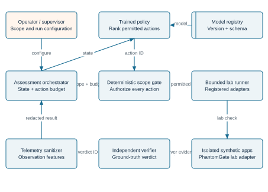

## 4.1 Separation of authority

The trained policy recommends an action. The deterministic gate decides whether it may execute. The verifier decides whether evidence supports a finding. These roles remain distinct to prevent a plausible model output from becoming authorization or ground truth.

## 4.2 Existing and proposed components

Existing Go packages provide the repository foundation. The orchestrator, scope gate, ML registry, sanitized dataset pipeline, and independent verifier shown here are proposed additions. No executable offensive capability is added by this report revision.

# 4. System design - context DFD

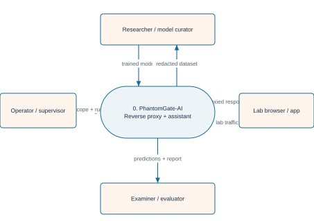

## 4.3 DFD conventions

This report uses a context diagram with process 0, followed by Level 1 processes 1.0-5.0 and a Level 2 decomposition of process 3.0. Rounded nodes denote processes, tinted rectangles denote external entities, and marked rectangles denote data stores. Arrows carry data rather than execution order.

The boundary includes assessment coordination and evidence handling. The lab applications and researcher are external entities. No direct external-to-store flow is permitted; data passes through a validating process.

# 4. System design - DFD Level 1

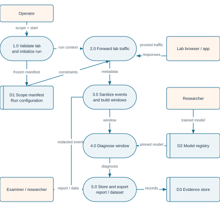

## 4.4 Balancing and data stores

Operator scope enters 1.0; checks and observations cross the lab boundary through 3.0 and 4.0; artifacts leave through 5.0. The researcher supplies a model to 2.0. These preserve the context flows; the researcher entity is repeated for readability.

D1 records immutable scope and run parameters. D2 stores redacted events, verifier verdicts, and evidence references. Training exports omit hidden scenario configuration and ground-truth labels from model feature columns.

# 4. System design - DFD Level 2

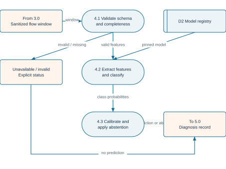

## 4.5 Gate behavior

Authorization checks include target identity, action membership, input schema, remaining budget, run state, and adapter preconditions. Rejection is an auditable result, not a trigger to let the model invent an alternative target.

A timeout or missing result becomes an indeterminate observation. It is never converted automatically into a confirmed weakness. Every allowed adapter call consumes the predefined cost, including failed attempts, to preserve fair budget comparisons.

# 4. System design - use cases

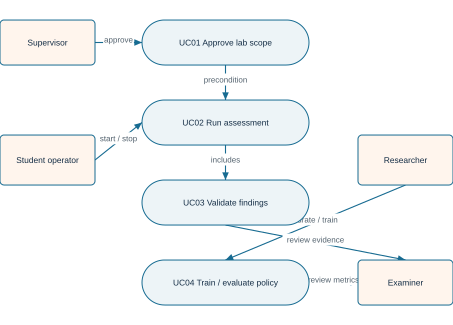

**Table 4.1 - Use-case summaries**
| Case | Precondition | Success / alternate outcome |
| --- | --- | --- |
| UC01 | Provisioned lab and owner approval | Frozen scope; invalid manifest rejected |
| UC02 | Approved scope, reset lab, model available | Budgeted run; stop or timeout triggers cleanup |
| UC03 | Evidence IDs and verifier available | Confirmed / rejected / indeterminate finding |
| UC04 | Versioned redacted dataset and split manifest | Model + metrics; incompatible schema rejected |
UC02 includes scope validation on each action and evidence processing after each result. UC04 belongs to the research workflow and does not change the authority of UC01.

# 4. System design - misuse cases

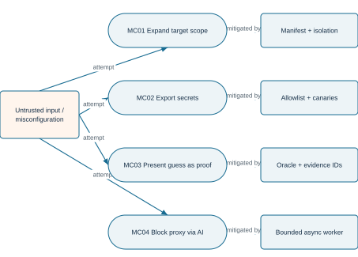

## 4.6 Abuse prevention as system behavior

Misuse cases are requirements tests. A model-recommended external target must be rejected. Secret canaries must disappear before export. A policy-generated assertion must not create a finding without verifier evidence. Exhausted budgets and stop requests must prevent new adapter executions.

The operator remains responsible for lab authorization. Network-level isolation supplements the application gate; neither a prompt nor a policy confidence score is a security boundary.

# 4. System design - activity and state

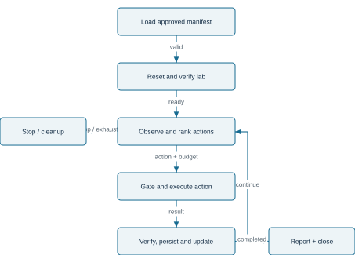

## 4.7 Run-state transition specification

CREATED becomes VALIDATED after scope checks, then READY after reset and health checks. READY becomes RUNNING only on explicit start. RUNNING transitions to STOPPING on completion, cancellation, exhausted budget, or fatal failure. STOPPING becomes CLOSED only after cleanup evidence; cleanup failure produces FAILED_REQUIRES_REVIEW.

The activity loop above describes control flow. Figure 4.12 separately captures the persistent state machine, including failure and restart behavior.

# 4. System design - sequence diagram

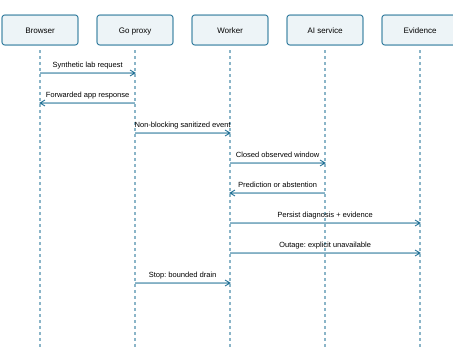
## 4.8 Normal and exceptional interaction

Each policy decision carries run ID, schema version, state digest, and ranked action IDs. The gate binds its permit to the current run and action; changing the state or target requires a new check. The runner returns an observation reference rather than a model-authored success claim.

On denial, no adapter call occurs and the orchestrator records the rejection. On timeout, cancellation propagates to the runner and the verifier records an indeterminate result. The next state is constructed only from sanitized observations available to all compared policies.

# 4. System design - domain class model

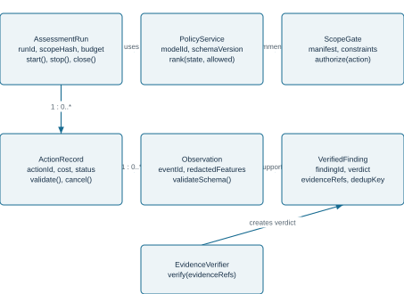

## 4.9 Class responsibilities

These are proposed conceptual classes, not existing Go type declarations. The policy has no execution method. Action adapters implement a registered interface with bounded inputs and cancellation. The verifier owns finding verdicts; the reporting layer reads immutable verified records.

Persistence entities are detailed in the next diagram. Class associations describe responsibilities and object relationships rather than database foreign keys.

# 4. System design - entity relationship diagram

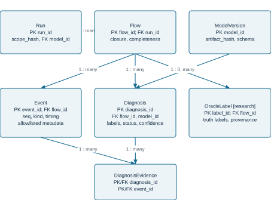

## 4.10 Integrity and retention

Foreign keys prevent orphan evidence. A unique key on run_id and dedup_key avoids counting repeated observations as new findings. FindingEvidence implements the many-to-many relationship between findings and events. ModelVersion records provenance rather than storing executable model content in the database.

Store only redacted values in event payloads. Configure retention and deletion for each run. Use transactions for action completion, evidence insertion, and verifier verdicts.

# 4. System design - deployment

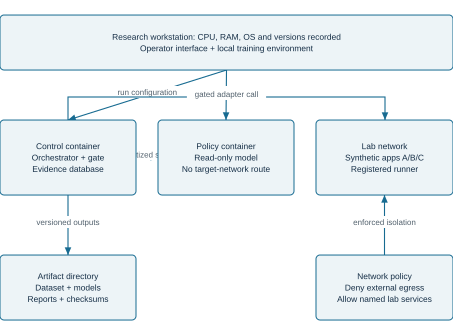

## 4.11 Deployment constraints

The policy container cannot directly contact lab targets. The runner has only the network access required for the frozen scenario. Training artifacts are mounted read-only during evaluation. The model service accepts no arbitrary shell commands or executable serialized objects from untrusted sources.

Containers improve repeatability but do not alone establish isolation. Verify routing, name resolution, host access, and egress denial before each assessment batch.

# 4. System design - state and data lifecycle

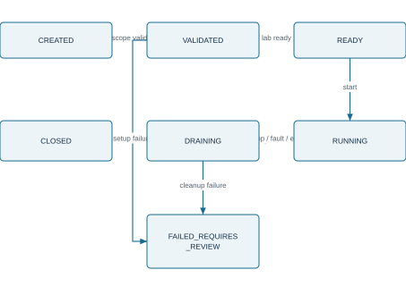

## 4.12 Crash and resume rules

A restarted controller never resumes a RUNNING record silently. It marks the interrupted run for review, verifies cleanup, and requires a new run or an explicitly documented resume protocol. CLOSED is immutable except for retention metadata.

## 4.13 Data lifecycle

Collect minimal telemetry, redact before durable storage, validate its schema, bind it to a run and action, derive verified labels, export a versioned dataset, then apply retention. Keep training splits and final test manifests immutable. Store model artifacts with checksums and training provenance.

# 5. AI methodology - learning formulation

## 5.1 Decision problem

At step t, the policy receives observation state x_t, a permitted action mask A_t, and remaining budget b_t. It returns a ranking over A_t or STOP. Only the independently authorized top action is executed. The environment is partially observable; the feature state is not assumed to reveal all hidden application properties.

## 5.2 Initial supervised approach

Expert annotators label one or more useful next actions for sampled training states using documented assessment criteria. Record disagreements and acceptable alternatives rather than forcing a single arbitrary action. Train a classifier or action ranker on state-action examples, grouping all examples from the same scenario family into the same split.

For a practical first implementation, compare multinomial logistic regression with gradient-boosted trees. Candidate features include completed-check indicators, observed outcome categories, evidence completeness, timeouts, and budget remaining. Action identity may be an input to a pairwise ranker; raw target names and hidden weakness flags may not.

## 5.3 Objective and decision rule

Fit the model using a documented classification or ranking loss with class weights chosen on training data. Tune hyperparameters and abstention thresholds on validation data only. Mask disallowed actions before selection; if no admissible action remains or confidence is insufficient, STOP or request operator review.

## 5.4 Scope of model training

The students train these policies themselves; using an API to generate a report is not the AI contribution. Reinforcement learning is a future extension requiring a reliable simulator and independently verified rewards. It is not required for the initial FYP.

# 5. AI methodology - dataset and pipeline

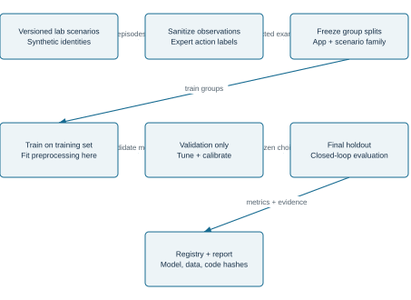

## 5.5 Sampling and labels

Begin with a pilot to estimate class balance and annotation effort. A provisional collection target is 300-600 resettable assessment episodes across three lab applications and multiple configuration families; this is a planning estimate, not a guarantee of adequate statistical power. Freeze sample-size decisions using pilot variance before final evaluation.

Training labels describe useful next actions. Evaluation labels describe independently verified weaknesses. The model never receives the latter as live input. Avoid duplicated templates or near-identical traces crossing split boundaries.

# 5. AI methodology - features and uncertainty

**Table 5.1 - Proposed observation schema**
| Feature group | Examples | Restriction |
| --- | --- | --- |
| Assessment progress | Completed-check bitmap; remaining budget | No future outcomes or hidden scenario metadata |
| Observed behavior | Result category; redirect count; timeout flag | Only measurements available to every policy |
| Evidence quality | Missing-field count; verifier status from prior step | No unexecuted-check labels |
| Action context | Registered ID; fixed cost; observed preconditions | No unrestricted command text |
| Excluded data | Passwords, cookie values, auth headers, raw identifiers | Never exported as model inputs |
## 5.6 Calibration and abstention

Calibrate confidence on validation groups using a method appropriate to sample size. Report calibration error or Brier score along with the proportion of states on which the policy abstains. Compare coverage at matched abstention rules or count STOP decisions explicitly so selective reporting cannot inflate performance.

## 5.7 Distribution shift and feedback

Test missing fields, altered latency, application-family holdouts, and previously unseen combinations of known configuration factors. Detect schema incompatibility deterministically. Unexpected observations should produce a bounded stop or review request, not retraining during the final test.

## 5.8 Reproducibility

Record dataset hashes, split membership, annotation guideline version, code commit, dependency lockfile, random seeds, hyperparameters, model checksum, and actual hardware. Do not refit preprocessing on validation or test data.

# 6. Implementation and integration plan

## 6.1 Baseline provenance

The source baseline inspected for report revision is Un-9oon/PhantomGate commit 8ae8437a4900b03fbaf187ac98bbde6127687efa [10]. The repository contains a Go proxy, storage, configuration, phishlet handling, a local fake target, and tests. File presence and source review do not establish that every feature works or that all tests pass.

**Table 6.1 - Proposed module allocation**
| Module | Responsibility | Implementation status |
| --- | --- | --- |
| research/orchestrator | Run state, budget and cancellation | Proposed |
| research/scope | Manifest validation and action permits | Proposed |
| research/adapters | Bounded synthetic-lab action interface | Proposed |
| research/evidence | Sanitization, verification, deduplication | Proposed |
| ml/data + ml/train | Dataset preparation and policy training | Proposed |
| ml/evaluate | Held-out closed-loop comparisons | Proposed |
| reports/ | Evidence-linked academic and run reports | This revised design report only |
## 6.2 Integration contract

Retain existing code attribution and isolate new research modules. Expose typed lab observations through a narrow adapter rather than letting the model operate existing console commands freely. Add schema compatibility checks at each boundary. Audit storage and lifecycle behavior before using the framework as an experiment runner.

## 6.3 Delivery stages

Implement the resettable lab and verifier first, then fixed and heuristic baselines, then data collection and model training. A learned policy cannot be evaluated credibly on top of an unreliable ground-truth pipeline.

# 6. Reliability and security engineering

**Table 6.2 - Robustness work and verification**
| Concern | Proposed change | Verification |
| --- | --- | --- |
| Durability | Transactional evidence store or atomic snapshot replacement | Interrupted-write and recovery fixtures |
| Concurrency | Immutable read snapshots; clear ownership | Concurrent serialization/mutation tests and race checks |
| Lifecycle | Explicit timeouts, cancellation and readiness | Listener failure, timeout and stop tests |
| Resources | Bounded queues, event sizes and run budgets | Sustained-load and backpressure tests |
| Privacy | Redaction before persistence and export | Seeded-secret canary scans |
| Model integrity | Pinned model/schema hashes; trusted loading | Tampered-artifact and schema-mismatch tests |
| Auditability | Append-only action/verdict records with provenance | Evidence-reference and deduplication validation |
## 6.4 Evidence-based readiness

The original report's assertions of universal MFA bypass, zero latency, zero technical debt, and certified production readiness are withdrawn in this revision. The previous report's claimed test passes have not been reproduced here. Test existence is acknowledged without treating it as a successful run.

Robustness claims must state the supported OS, workload, hardware, failure cases, and measured results. NIST guidance [8] and WebAuthn [9] inform design assumptions; this report makes no certification or standards-compliance claim.

# 7. Evaluation protocol

## 7.1 Experimental design

Use three synthetic applications with independently varied authentication-policy configurations. Hold out an entire application for testing and rotate the held-out application. Within the remaining applications, keep scenario families and near-duplicate configurations together when forming training and validation groups. Keep a separate final holdout for any final model selection claim.

## 7.2 Baselines and fairness

Compare a fixed checklist, uniform random selection among admissible untried actions, an expert-defined heuristic, logistic regression, and gradient-boosted trees. All policies receive the same observations, reset states, action costs, allowed actions, and termination rules. A heuristic must be designed before final-test inspection. Report its design effort alongside model-labeling effort.

## 7.3 Primary endpoint

For each run, count distinct confirmed weakness classes or instances under a predefined deduplication rule. Plot mean validated coverage C(B) against action budget B. Repeated evidence for the same underlying weakness counts once. Compare policies on the same scenario/seed pairs.

## 7.4 Statistical analysis

Use paired differences and bootstrap confidence intervals resampling independent scenario families, not individual correlated requests. Report per-application results as well as aggregates. Choose the number of independent repetitions after the pilot; a provisional minimum of five policy seeds is a planning floor, not a substitute for power analysis.

## 7.5 Ablations

Remove progress features, remove outcome features, disable calibration, and replace independent validation with naive success flags for an offline sensitivity study. Do not weaken authorization to conduct an ablation. Record the effect on coverage and false findings.

# 7. Evaluation - metrics and planned results

**Table 7.1 - Metrics and interpretation**
| Metric | Definition | Interpretation |
| --- | --- | --- |
| Coverage at budget B | Distinct verified findings before budget exhaustion | Primary comparison; fixed deduplication rule |
| Finding precision | Confirmed / all reported findings | Indeterminate reports remain visible |
| Time to first confirmed finding | Elapsed time including policy overhead | Report no-finding runs as censored |
| Decision latency | p50 / p95 per policy decision | State hardware, batch size and warmup |
| Abstention rate | STOP/review decisions due to uncertainty / decisions | Report with coverage, not in isolation |
| Scope / privacy failures | Executed denied actions / leaked canaries | Must be zero in defined acceptance tests |
## 7.6 Results status

No model has been trained or evaluated as part of this document revision. No accuracy, coverage improvement, latency, or robustness result is available. The final report should replace this section with measured tables, coverage curves, confidence intervals, failure analyses, and links to immutable experiment manifests.

**Table 7.2 - Results template (unmeasured)**
| Policy | Coverage @ fixed B | Precision | p95 decision time |
| --- | --- | --- | --- |
| Fixed checklist | Not measured | Not measured | Not measured |
| Random / heuristic | Not measured | Not measured | Not measured |
| Logistic regression | Not measured | Not measured | Not measured |
| Gradient-boosted trees | Not measured | Not measured | Not measured |
Do not substitute illustrative numbers for actual results. Preserve unsuccessful runs and explain exclusions using criteria fixed before analysis.

# 8. Project management and feasibility

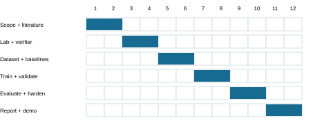
**Table 8.1 - Milestones and exit criteria**
| Weeks | Deliverable | Exit criterion |
| --- | --- | --- |
| 1-2 | Scope, literature and protocol | Supervisor-reviewed question and frozen pilot plan |
| 3-4 | Lab, reset and verifier | Known fixtures pass; scope and redaction checks pass |
| 5-6 | Dataset pilot and baseline policies | Label agreement, split audit and sample plan recorded |
| 7-8 | Trained and calibrated policies | Reproducible training; validation-only selection |
| 9-10 | Held-out evaluation and reliability | Paired results, confidence intervals and fault tests |
| 11-12 | Report, demo and reproducibility pack | Independent rerun and source/PDF consistency |
## 8.1 Resources and costs

Plan for one local workstation, isolated application services, Python ML tooling, the Go framework, and storage for redacted traces. Use existing hardware where feasible. No monetary budget is asserted because local procurement prices and available resources were not supplied. Record actual costs, licenses, compute time, and contributor effort in the final submission.

# 8. Risk register and academic integrity

**Table 8.2 - Project risks**
| Risk | Likelihood / impact | Mitigation |
| --- | --- | --- |
| Dataset leakage | Medium / high | Group splits; duplicate audit; freeze final holdout |
| Insufficient labels | High / medium | Pilot annotation effort; prioritize small models |
| Simulator artifacts | High / high | Hold out apps; vary benign conditions; disclose transfer limits |
| No ML improvement | Medium / medium | Strong baselines; publish null results honestly |
| Unsafe target selection | Low / high | Independent gate plus network isolation |
| Unreliable verifier | Medium / high | Known fixtures; manual evidence review subset |
| Deadline pressure | Medium / high | Supervised policy first; RL deferred |
| Template mismatch | Medium / low | Apply university template before submission |
## 8.2 Attribution and ethical conduct

Credit the existing repository and all reused code. Identify student-authored modules, dataset generation, annotation, model training, and evaluation separately. Do not claim ownership of prior interception techniques or paper contributions. Report the use of writing or coding assistance according to university policy.

## 8.3 Limitations

Synthetic applications cannot establish real-world attack success or safety. Three applications provide limited external validity. Expert labels encode annotator preferences. A finite catalogue constrains what can be discovered. An offline-trained policy can encounter unseen states during execution. These limitations should remain explicit even if laboratory results are positive.

# 9. Conclusion and expected deliverables

PhantomGate-Lab reframes the existing framework as a component of an AI-assisted offensive assessment workflow in an isolated laboratory. Its research objective is to evaluate learned test prioritization, not to claim a new interception technique. The AI recommends bounded actions; separate mechanisms enforce authorization and validate findings.

## 9.1 Expected deliverables

- A versioned, resettable synthetic authentication laboratory and rules-of-engagement manifest.
- A registered action catalogue, deterministic scope gate, and evidence verifier.
- A redacted dataset with annotation guidelines, group splits, and provenance.
- Student-trained baseline and ranking models with documented hyperparameters.
- A fair closed-loop evaluation with independently validated findings and uncertainty analysis.
- Reliability evidence, an academic report, a demonstration script, and a reproducibility package.
## 9.2 Conditions for the final claims

Claim a research contribution only after the related-work comparison and experiments establish what is added. Claim improved coverage only against the stated baselines, budgets, and held-out conditions. Claim robustness only within the workloads and failure cases actually tested. If the model does not improve over the heuristic, retain that result and analyze why.

## 9.3 Immediate next step

Confirm the university template and team details, agree on the finite lab action catalogue with the supervisor, implement the verifier and reset process, and complete a small pilot before committing to a larger training dataset.

# References

[1] J. Schwartz and H. Kurniawati. Autonomous Penetration Testing using Reinforcement Learning. arXiv:1905.05965, 2019. Preprint.https://arxiv.org/abs/1905.05965

[2] N. Becker, D. Reti, E. V. Ntagiou, M. Wallum, and H. D. Schotten. Evaluation of Reinforcement Learning for Autonomous Penetration Testing using A3C, Q-learning and DQN. arXiv:2407.15656, 2024. Preprint.https://arxiv.org/abs/2407.15656

[3] G. Deng et al. PentestGPT: Evaluating and Harnessing Large Language Models for Automated Penetration Testing. 33rd USENIX Security Symposium, pp. 847-864, 2024.https://www.usenix.org/conference/usenixsecurity24/presentation/deng

[4] Microsoft Research. CyberBattleSim. Research software project; source release discussed in 2021.https://www.microsoft.com/en-us/research/project/cyberbattlesim/

[5] R. Simon, J. Carrasquel, E. M. Antoun, W. Mees, and P. Libin. NASimJax: A GPU-Accelerated Policy Learning Framework for Penetration Testing. arXiv:2603.19864v3, revised 4 October 2026. Preprint.https://arxiv.org/abs/2603.19864v3

Sources checked on 21 October 2026. This focused review does not establish exhaustive coverage of the research literature.

# References - continued

[6] B. Kondracki, B. Amin Azad, O. Starov, and N. Nikiforakis. Catching Transparent Phish: Analyzing and Detecting MITM Phishing Toolkits. ACM CCS, 2021. DOI: 10.1145/3460120.3484765.https://briankondracki.com/assets/pdf/catching_transparent_phish.pdf

[7] E. Ulqinaku, H. Assal, A. Abdou, S. Chiasson, and S. Capkun. Is Real-time Phishing Eliminated with FIDO? Social Engineering Downgrade Attacks against FIDO Protocols. 30th USENIX Security Symposium, pp. 3811-3828, 2021.https://www.usenix.org/conference/usenixsecurity21/presentation/ulqinaku

[8] K. Scarfone, M. Souppaya, A. Cody, and A. Orebaugh. Technical Guide to Information Security Testing and Assessment. NIST SP 800-115, September 2008. Guidance document.https://nvlpubs.nist.gov/nistpubs/Legacy/SP/nistspecialpublication800-115.pdf

[9] W3C. Web Authentication: An API for accessing Public Key Credentials - Level 2. W3C Recommendation, 8 April 2021. Specification.https://www.w3.org/TR/webauthn-2/

[10] Un-9oon/PhantomGate. Source repository and original project report. Baseline commit 8ae8437a4900b03fbaf187ac98bbde6127687efa. Software artifact.https://github.com/Un-9oon/PhantomGate/tree/8ae8437a4900b03fbaf187ac98bbde6127687efa

# Appendix A. Validation and traceability matrix

**Table A.1 - Planned acceptance tests**
| Test | Requirement | Expected result / evidence |
| --- | --- | --- |
| AT01 Manifest rejection | FR01, NFR01 | Invalid or external target denied before execution |
| AT02 Budget exhaustion | FR03 | No new action after the budget reaches zero |
| AT03 Secret canary | FR04, NFR02 | No seeded secret in DB export, model inputs or report |
| AT04 Verifier fixtures | FR06, NFR07 | Known true/false/unknown cases classified correctly |
| AT05 Evidence deduplication | FR06 | Repeated observations do not inflate findings |
| AT06 Schema mismatch | FR05 | Incompatible model/state rejected explicitly |
| AT07 Crash recovery | NFR03 | Committed evidence intact; interrupted run reviewed |
| AT08 Concurrent access | NFR04 | No mutable snapshot leakage or detected races |
| AT09 Cancellation | FR07, NFR06 | Runner stops; cleanup status persisted |
| AT10 Held-out replay | O3 | Split hash stable; identical paired scenario seeds |
| AT11 Policy unavailable | FR03, FR05 | Stop or explicitly configured fixed baseline; no hidden fallback |
| AT12 Report integrity | FR08 | Each finding resolves to verified evidence |
Execution status for every acceptance test above: not run in this report revision. Archive actual commands, logs, environment details, timestamps, and pass/fail outcomes when implementation is available.

# Appendix B. Detailed use and misuse specifications

## UC02 - Run a bounded assessment

Actor: student operator. Preconditions: approved immutable scope, reset lab, compatible model, and configured budget. Trigger: explicit start request. Main flow: validate manifest; establish readiness; construct sanitized state; rank actions; enforce scope and budget; execute one registered action; verify and persist evidence; repeat or stop; clean up; export report. Postcondition: closed run with traceable actions and verified findings.

Alternate flows: invalid scope -> reject before start; model unavailable -> stop or use a predeclared baseline with its identity recorded; adapter timeout -> indeterminate evidence; stop request -> cancel and clean up; cleanup failure -> review-required state. No alternate flow expands target scope.

## MC01 - Attempt to expand authorization

Threat: a malformed model response or operator input names an external target or unregistered action. Expected control: gate rejects it and records the reason. Acceptance evidence: denial record and absence of a corresponding network request. Residual risk: faulty network policy; verify egress independently.

## MC03 - Attempt to count unsupported findings

Threat: a model or adapter reports success without supporting server evidence. Expected control: the independent verifier marks the case rejected or indeterminate; only confirmed deduplicated findings enter the primary coverage metric. Acceptance evidence: fixtures with fabricated status messages and missing references.

## Submission checklist

Complete team and institution fields; obtain real signatures; apply the institutional template; confirm reference style; attach actual results; include attribution and assistance disclosure; verify source/PDF consistency; demonstrate clean reset and reproducibility.

# Appendix C. Bounded assessment catalogue

The following conceptual action categories make the proposed policy concrete. They are not commands or exploit procedures. Each requires a supervisor-approved lab adapter with explicit inputs, preconditions, cost, timeout, and independently verifiable evidence. The complete catalogue must be frozen before comparative evaluation.

**Table C.1 - Proposed registered action categories**
| ID | Lab assessment category | Expected observation |
| --- | --- | --- |
| A01 | Inspect authentication-response metadata | Normalized flags and response category |
| A02 | Compare access decisions for synthetic test roles | Expected versus observed authorization verdict |
| A03 | Check synthetic-session expiry behavior | Server-confirmed expired/active state |
| A04 | Check logout invalidation in a resettable fixture | Verifier-confirmed session lifecycle result |
| A05 | Assess configured recovery-policy consistency | Observed policy category and evidence reference |
| A06 | Repeat a prior lab check after remediation | Independent before/after comparison |
| STOP | End assessment and clean up | Closed run or cleanup-review state |
## Action contract

Inputs: run ID, registered category ID, lab target ID, typed parameters, and current state digest. Outputs: status, observation reference, elapsed time, charged cost, and cancellation status. A category ID never grants permission to discover arbitrary targets or invoke unrestricted tools.

## Ground truth and success criteria

The scenario manifest defines expected application behavior. The verifier compares observed evidence with that expectation and issues a confirmed, rejected, or indeterminate verdict. Scenario configuration is available to the verifier and evaluation harness only; the policy learns from prior observed results, not hidden labels.
