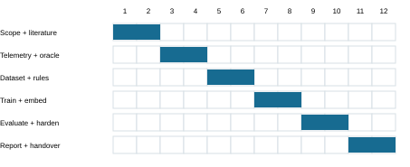

# Title page

**Reverse Proxy with an AI Assistant for Authentication Outcome and Failure Diagnosis**
Revision 3.0 - FYP design and handover. Prepared 22 October 2026.
Team, university, department, degree, supervisor and academic session: not supplied.

# Declaration and document status

This final-year-project design report defines the current agreed scope of PhantomGate-AI: retain the existing reverse proxy as the main system and embed a separately trained assistant for evidence-grounded authentication-outcome and technical-failure diagnosis in controlled laboratories. It supersedes the earlier action-selection-agent report.

## Declaration and attribution

The original PhantomGate framework is an existing software foundation, not a new student invention. Students must identify reused code, their own instrumentation, dataset, trained model, reliability changes, evaluation, and writing assistance according to institutional policy. This draft is unsigned and does not assert approval or authorship by any named person.

**Administrative details**
| Field | Submission status |
| --- | --- |
| Student names / registration IDs | Not supplied |
| University / department / degree | Not supplied |
| Supervisor / academic session | Not supplied |
| Declaration and approval signatures | Pending; obtain actual signatures |
| Revision / prepared | 3.0 / 22 October 2026 |
| Implementation and experiment status | Proposed; no trained-model results claimed |
## Formatting and intended use

A conventional A4 FYP format is used because no institution template was supplied. Replace the cover and approval wording with the institution requirements. Add genuine acknowledgements before submission. The implementation handover chapter and companion PROJECT_SPEC.json are designed to make the scope understandable without reading this conversation.

# Abstract

PhantomGate-AI proposes an AI-assisted reverse-proxy framework for controlled authentication-security assessments. The existing Go reverse proxy remains the primary traffic-processing system. A non-blocking observation pipeline supplies sanitized event sequences to a student-trained diagnostic model. The assistant estimates authentication-flow outcomes and associated technical-failure categories, identifies insufficient evidence, and returns evidence-linked explanations for an operator. It does not control routing, generate payloads, select targets, or modify assessment authorization.

The research problem is the interpretation of incomplete and ambiguous laboratory observations: a failed interaction may reflect application rejection, proxy failure, upstream unavailability, client interruption, or insufficient telemetry. The proposed approach separates model predictions from ground truth obtained through independently instrumented synthetic applications and verified fault injections. Outcome and failure labels are modeled separately because an incomplete flow and a technical failure can coexist.

The evaluation compares explicit rules, logistic regression, gradient-boosted trees, and an optional small sequence model using application- and scenario-group holdouts. Measurements include per-class precision and recall, macro-F1, selective prediction risk, calibration, missing-event sensitivity, and added resource overhead. Conventional engineering work addresses timeouts, cancellation, storage durability, immutable snapshots, bounded queues, and shutdown. Expected deliverables are an enhanced reverse proxy, a trained assistant, a labeled laboratory benchmark, reproducible evaluations, and an implementation handover package. Novelty and robustness remain claims to validate, not established achievements.

## Keywords

Reverse proxy; penetration-testing laboratory; authentication assessment; supervised learning; failure diagnosis; sanitized telemetry; uncertainty; cross-application evaluation.

## One-sentence project identity

Keep PhantomGate as the reverse proxy; add a trained, read-only assistant that explains observed assessment outcomes using sanitized telemetry and independent verification.

# Table of contents

| Section | Page |
| --- | --- |
| Declaration and document status | i |
| Abstract | ii |
| List of figures, tables and abbreviations | iv |
| 1. Introduction and project identity | 1 |
| 2. Literature review - method and prior systems | 3 |
| 3. Requirements and scope | 6 |
| 4. System architecture | 8 |
| 5. AI methodology - labels and ground truth | 20 |
| 6. Technical implementation and code mapping | 24 |
| 7. Evaluation methodology | 28 |
| 8. Market value and practical feasibility | 30 |
| 9. Project management and risk register | 31 |
| 10. Conclusion and future work | 32 |
| 11. Implementation handover - read this first | 33 |
| References | 36 |
| Appendix A. Submission and reproducibility checklist | 38 |

# List of figures, tables and abbreviations

| Figure | Title | Page |
| --- | --- | --- |
| 4.1 | Reverse proxy with an observational AI assistant | 8 |
| 4.2 | Context DFD: lab traffic and diagnostic artifacts | 9 |
| 4.3 | Level 1: forwarding, observation, diagnosis and export | 10 |
| 4.4 | Level 2: diagnostic process 4.0 | 11 |
| 4.5 | Use cases for the embedded assistant | 12 |
| 4.6 | Misuse cases and controls | 13 |
| 4.7 | Observed flow and asynchronous diagnosis activity | 14 |
| 4.8 | Assessment interaction sequence | 15 |
| 4.9 | Conceptual domain classes | 16 |
| 4.10 | Diagnostic evidence and research-label schema | 17 |
| 4.11 | Isolated lab deployment with a local inference service | 18 |
| 4.12 | Persistent run lifecycle | 19 |
| 5.1 | Training pipeline with independent research labels | 22 |
| 9.1 | Proposed twelve-week schedule | 31 |
| Table | Page |
| --- | --- |
| Administrative details | i |
| Table 1.1 - Objectives and deliverables | 2 |
| Table 2.1 - Research comparison | 5 |
| Table 3.1 - Functional requirements | 6 |
| Table 3.2 - Proposed quality targets | 7 |
| Table 4.1 - Use-case outcomes | 12 |
| Table 5.1 - Version 1 label taxonomy | 20 |
| Table 5.2 - Allowlisted input design | 21 |
| Table 6.1 - Existing files and proposed integration | 24 |
| Table 6.2 - Proposed new modules | 25 |
| Table 6.3 - Proposed local diagnostic interface | 26 |
| Table 6.4 - Reliability work | 27 |
| Table 7.1 - Measures of success | 29 |
| Table 8.1 - Positioning and alternatives | 30 |
| Table 9.1 - Relative milestone plan | 31 |
| Table 11.1 - Source-of-truth hierarchy | 33 |
| Table 11.2 - Version 1 event envelope | 34 |
| Table 11.3 - Required implementation checks | 35 |
AI: Artificial Intelligence; AiTM: Adversary-in-the-Middle; DFD: Data Flow Diagram; ERD: Entity Relationship Diagram; FYP: Final Year Project; ML: Machine Learning; RCA: Root Cause Analysis; SSO: Single Sign-On; MFA: Multi-Factor Authentication; PK/FK: Primary/Foreign Key.

# 1. Introduction and project identity

## 1.1 Background

A reverse proxy handles requests and responses between a browser and an upstream web application. In this project it is used inside an authorized laboratory to observe synthetic authentication workflows. An endpoint payload is not a prerequisite for the proposed reverse-proxy experiment. The research assistant analyzes observations; the reverse proxy remains the product being enhanced.

## 1.2 Problem statement

A failed authentication experiment does not by itself establish a security result. Application rejection, upstream faults, local proxy errors, interrupted clients, and missing events can produce superficially similar traces. Incorrect interpretation can lead to unsupported assessment conclusions. A single HTTP status code is insufficient to establish authenticated state or the root cause of a failure.

## 1.3 Aim

Enhance PhantomGate with a student-trained diagnostic assistant and measured reliability improvements, while keeping its reverse-proxy architecture central and independently verifying the assistant's conclusions in a controlled laboratory.

## 1.4 Research question

Can a model trained on sanitized reverse-proxy telemetry distinguish authentication outcomes and technical-failure categories on unseen laboratory applications more accurately than rule-based analysis, while keeping overhead bounded?

## 1.5 Scope decision

The earlier proposal for an autonomous next-action policy is superseded. This report specifies outcome and failure diagnosis. Automated payload delivery, exploit selection, phishing optimization, autonomous traffic rewriting, and universal MFA-bypass claims are outside the implementation scope.

# 1. Objectives and proposed solution

**Table 1.1 - Objectives and deliverables**
| ID | Objective | Evidence / deliverable |
| --- | --- | --- |
| O1 | Retain and instrument the Go reverse proxy | Metadata events without inference in the forwarding path |
| O2 | Train an embedded diagnostic assistant | Versioned dataset, labels, model and training configuration |
| O3 | Validate outcomes independently | App-oracle and verified fault-injection records |
| O4 | Evaluate generalization and usefulness | Rules and ML comparisons on held-out apps |
| O5 | Improve measured reliability | Load, failure, recovery and cancellation test records |
| O6 | Enable implementation handover | Code map, contracts, milestones and acceptance tests |
## 1.6 Proposed solution

Collect allowlisted metadata from the proxy; assign pseudonymous correlation IDs; build bounded per-flow windows; classify outcomes and failures; abstain on insufficient evidence; and display structured diagnoses with references to observed events. Compare predictions with the independent oracle only in the evaluation pipeline.

## 1.7 Meaning of accuracy and robustness

Accuracy refers to correct diagnostic predictions and supported conclusions. Robustness refers to reliable system behavior under load, missing data, dependency failures, and interruption. AI is not a substitute for timeouts, durable storage, concurrency ownership, or correct network handling.

## 1.8 Academic balance

The Penetration Testing contribution is a scoped authentication assessment workflow, evidence verification, reporting and remediation retests. The AI contribution is dataset design, student-run training, model comparison, uncertainty evaluation and generalization analysis.

# 2. Literature review - method and prior systems

## 2.1 Review method and limitations

This focused narrative review uses primary publication pages, author manuscripts, research records, standards, and the baseline repository. Sources were checked on 22 October 2026. Queries covered automated penetration testing, reverse-proxy authentication assessment, log anomaly detection, and failure diagnosis. This is not an exhaustive systematic review and does not establish that the proposed combination is globally unique.

## 2.2 AI-assisted penetration testing

PentestGPT [1] evaluates LLM-assisted penetration testing and addresses loss of assessment context through interacting modules. Its contribution establishes that AI-guided assessment is prior work. AutoPentester [2] studies iterative tool-driven automation and reports benchmark comparisons. Adding an assistant to a security tool therefore cannot itself be claimed as novel.

## 2.3 Reverse-proxy phishing analysis

Catching Transparent Phish [3] analyzes MITM phishing toolkits and develops network-based detection. It provides context for the existing framework but asks a different question from diagnosing the reliability and outcome of a controlled experiment. Its reported detector performance must not be transferred to this proposed model.

## 2.4 Authentication semantics

Ulqinaku et al. [4] study social-engineering downgrade from FIDO to alternative authentication methods. WebAuthn [8] specifies relying-party and origin validation. These sources do not support blanket claims that a reverse proxy defeats all MFA. The lab must distinguish protocol behavior, fallback policy, and infrastructure malfunction.

# 2. Literature review - diagnosis and candidate gap

## 2.5 Log-based learning is established

LogBERT [5] learns normal log-sequence patterns using self-supervised training and detects deviations. This establishes sequence-based log anomaly detection as prior work. An anomaly score does not automatically identify a specific authentication outcome or establish the cause of a failure.

LogRCA [6] studies root-cause candidate identification in distributed-service logs using semi-supervised learning and expert-labeled failures. Its existence means that AI-based failure diagnosis itself is not new. PhantomGate-AI must compare its task definition and evidence requirements with such work rather than comparing only with penetration-testing agents.

## 2.6 Candidate research gap

The reviewed systems emphasize general assessment automation, phishing-toolkit detection, or general service-log diagnosis. This proposal investigates a narrower task: jointly label authentication outcomes and technical-failure categories from secret-free proxy observations, with an independent lab oracle, explicit abstention, and held-out application evaluation.

That positioning is an inference from the reviewed sources, not a proven absence of related work. A follow-up review should search authentication-specific diagnosis, proxy observability, process mining, and uncertainty-aware log analysis before any first-of-its-kind claim.

## 2.7 Falsifiable contribution

A successful study would show useful diagnosis beyond well-designed rules under stated conditions. If known error flags already solve the task, or a heuristic matches the model on unseen apps, report that result. The contribution may then be a benchmark, replication, or negative-result study rather than a superior AI algorithm.

# 2. Related-work comparison and novelty boundaries

**Table 2.1 - Research comparison**
| Source | Established scope | Proposed distinction to evaluate |
| --- | --- | --- |
| [1] PentestGPT, 2024 | LLM assessment assistance and context | Proxy-specific outcome/failure labels |
| [2] AutoPentester, 2025 | Iterative pentesting automation | Read-only diagnosis rather than action planning |
| [3] Transparent Phish, 2021 | MITM toolkit analysis and detection | Diagnosis of lab experiment observations |
| [4] FIDO downgrade, 2021 | User behavior and fallback attacks | Separate rejection from technical faults |
| [5] LogBERT, 2021 | Log-sequence anomaly detection | Task-specific labels and independent oracle |
| [6] LogRCA, 2024 | Distributed-service failure diagnosis | Authentication context; missing events; holdouts |
## 2.8 What can be original

Potential student contributions are a documented authentication-trace benchmark, a reproducible oracle-alignment method, a calibrated diagnostic model, and an integrated proxy assistant evaluated under application shift. Each contribution needs comparison with relevant existing work; a new project name or code integration is not sufficient.

## 2.9 What is not claimed

Reverse-proxy interception, generic AI assistants, log anomaly detection, root-cause analysis, and unseen-environment testing already have substantial prior work. The proposed model does not prove causation from correlations alone. Production certification and universal superiority are not claimed.

# 3. Requirements and scope

## 3.1 Actors and operating assumptions

A student operator starts scoped laboratory runs. A supervisor approves scope. A researcher curates labels and trains models. An examiner reviews repeatability and evidence. All applications and identities are synthetic and provisioned within an isolated lab; default external egress is denied.

**Table 3.1 - Functional requirements**
| ID | Requirement | Verification |
| --- | --- | --- |
| FR01 | Validate a frozen lab manifest before start | Reject unauthorized target or invalid manifest |
| FR02 | Emit allowlisted proxy metadata events | Schema and redaction tests |
| FR03 | Construct bounded correlated flow windows | Window, concurrency and missing-event fixtures |
| FR04 | Predict outcome and failure with confidence | Offline fixtures and model-contract tests |
| FR05 | Abstain when evidence is inadequate | Incomplete-window and schema-error tests |
| FR06 | Keep oracle labels separate from inference | Split and feature-allowlist audit |
| FR07 | Display evidence-linked diagnoses and reports | Every explanation references existing events |
| FR08 | Support disable, cancellation and cleanup | Model outage and shutdown tests |
## 3.2 Assistant authority

The assistant may summarize observed evidence, return diagnostic categories, identify missing observations, and suggest a repeat of an approved lab check for human review. It may not choose external targets, invoke shell commands, change routing, generate payloads, or declare a verified security finding without independent evidence.

# 3. Quality requirements and acceptance targets

**Table 3.2 - Proposed quality targets**
| ID | Requirement / initial target | Acceptance evidence |
| --- | --- | --- |
| NFR01 | No AI-dependent wait in request forwarding | Request path remains responsive during model outage |
| NFR02 | No secret values in exported model data | Canary scans and allowlist schema checks |
| NFR03 | Memory and queue capacity are bounded | Saturation test and observable drop counts |
| NFR04 | No detected data races in supported paths | Concurrent tests and Go race-check logs |
| NFR05 | Committed diagnosis records survive interruption | Crash-recovery tests |
| NFR06 | Local p95 diagnosis <= 250 ms after window closure | Measured on disclosed hardware |
| NFR07 | Proxy p95 overhead <= 10% at a declared load | Paired AI-off/on test with confidence interval |
| NFR08 | No new work after cancellation; cleanup <= 10 s | Cancellation and worker-drain tests |
These are provisional engineering acceptance targets, not achieved results. Freeze final thresholds after a pilot and before final evaluation. Specify the workload, network conditions, event rates and supported platform. An absolute latency limit should accompany relative overhead if the baseline is very fast.

## 3.3 Requirements traceability

O1 maps to FR01-FR03 and NFR01-NFR03; O2 maps to FR04-FR05; O3 maps to FR06-FR07; O4 maps to the held-out protocol; O5 maps to NFR04-NFR08; O6 maps to the handover chapter and acceptance matrix. AI failure reduces diagnostic availability, not forwarding availability.

# 4. System architecture

## 4.1 Data path versus assistant path

Browser-to-application forwarding is the primary path. Sanitized event emission uses a non-blocking bounded queue. A separate worker calls the model after a window closes. The request handler never waits for model inference. Full queues increment drop counters and mark affected windows incomplete.

## 4.2 Independent truth boundary

The oracle is deliberately absent from the live inference path. It is joined with frozen predictions only in the research evaluator. The model cannot read application ground-truth logs, injected-fault identifiers, scenario labels, or future events.

# 4. Context data-flow diagram

## 4.3 DFD notation and balancing

This report uses process 0 for the context diagram; Level 1 contains processes 1.0-5.0; Level 2 decomposes diagnostic process 4.0. Processes use rounded shapes, entities use tinted rectangles, and stores use marked rectangles. Arrows represent data flows, not scheduling.

The lab entity aggregates the browser and application for context readability. The operator supplies frozen scope and run parameters. The researcher supplies a compatible model and receives redacted exports. The evaluator compares predictions with a separately provisioned oracle.

# 4. DFD Level 1

## 4.4 Boundary flows

Process 5.0 writes D3 and exports reports to the examiner and redacted data to the researcher. These preserve the context flows. The model is frozen during a run; oracle labels never feed live inference.

# 4. DFD Level 2

## 4.5 Inference boundary

The diagnosis record includes predicted outcome, predicted failure category, confidence, abstention reason, model version and evidence IDs. It is not an independent verifier verdict. A model outage or schema mismatch produces UNAVAILABLE or INVALID_INPUT without changing traffic forwarding.

Missing telemetry is recorded separately from semantic flow outcome. A partial observation must not be labeled as an application rejection simply because no success event was seen.

# 4. Use-case diagram and specifications

**Table 4.1 - Use-case outcomes**
| Case | Preconditions | Success / alternative |
| --- | --- | --- |
| UC01 | Lab owner approval and manifest | Approved frozen scope / reject |
| UC02 | Healthy reset lab and approved scope | Traffic + observations / safe cancellation |
| UC03 | Diagnosis and event references | Human-reviewed assessment / insufficient evidence |
| UC04 | Frozen data and split manifest | Versioned model and metrics / invalid dataset |
UC03 shows predictions and verified evaluation labels distinctly. A diagnosis may be wrong; the interface must not call it a confirmed vulnerability automatically.

# 4. Misuse-case diagram

## 4.6 Testable misuse behavior

Reject an out-of-scope lab configuration before forwarding starts. Drop unapproved telemetry fields before enqueueing. Reject forged evidence references at report generation. Saturating or stopping the model service must not block the request handler.

The diagnosis interface accepts structured data, not executable instructions. If a future natural-language renderer is added, untrusted event content must remain data and its prose may not override the recorded labels or authorization.

# 4. Activity and lifecycle design

## 4.7 Window closure

Close a flow window on an observed terminal event, an idle timeout, cancellation, maximum event count, or maximum duration. Record the closure reason. Observation windows bound memory and inference input; they are not themselves proof that the application authenticated or rejected the synthetic user.

## 4.8 Evidence ordering

Use monotonic duration measurement within a process and sequence numbers per flow. Treat cross-process timestamps as approximate. Correlation identifiers are generated by the lab controller and validated as opaque identifiers; do not derive them from passwords or cookie values.

# 4. Sequence diagram

## 4.9 Runtime interaction

The proxy forwards the request independently of the diagnostic worker. Allowlisted metadata is emitted without waiting for inference. The worker submits a closed window to the local model and stores the returned diagnosis. The operator sees its confidence and status.

Separately, the research evaluator joins frozen predictions to oracle records. The live model cannot query that oracle. If the model is unavailable, the worker records UNAVAILABLE and uses bounded retry or skips according to configuration; it never silently claims a successful diagnosis.

# 4. Domain class model

## 4.10 Implementation meaning

Existing PhantomProxy is retained; other types are proposed. EventSink has non-blocking semantics. DiagnosisClient owns model communication, deadlines and schema compatibility. ResearchEvaluator is excluded from runtime inference dependencies.

The conceptual model is not a claim that these Go types already exist. The handover chapter maps responsibilities to existing files and proposed modules.

# 4. Entity relationship diagram

## 4.11 Separation and integrity

OracleLabel is stored in a research-only database or access boundary. A runtime prediction may not query it. Foreign keys protect evidence references. One model may produce many diagnoses; multiple models may score the same frozen flow in offline comparison.

Store no credential or session-token values in Event. Raw network bodies are not required for the proposed model. Persist versioned labels with provenance and reviewer status so corrections remain auditable.

# 4. Deployment diagram

## 4.12 Deployment choices

A local sidecar is an embedded product component even though it is a separate process. It avoids coupling Go forwarding to Python inference. Bind the model service to loopback or an isolated service network, authenticate local calls where appropriate, and deny its target access.

The offline evaluator may read both stores after predictions are frozen. The proxy and model receive no oracle credentials. Record actual OS support; the existing repository's cross-platform claims require verification.

# 4. Run-state machine

## 4.13 Degradation and restart

Assistant health is a separate dimension: HEALTHY, DEGRADED or UNAVAILABLE. A model outage need not end an otherwise authorized lab run. Show the diagnostic outage explicitly. Never translate missing predictions into NORMAL results.

After a crash, mark interrupted runs for review, recover committed records, and verify lab cleanup before any new run. DRAINING stops new work, cancels or bounds outstanding requests, and flushes accepted events within a documented deadline.

# 5. AI methodology - labels and ground truth

## 5.1 Two prediction heads

Use separate supervised targets: authentication outcome and technical-failure category. This avoids forcing mutually compatible conditions into one class. For example, an interrupted upstream connection can coexist with an incomplete authentication flow.

**Table 5.1 - Version 1 label taxonomy**
| Head | Values | Label authority |
| --- | --- | --- |
| Outcome | COMPLETE, REJECTED, INCOMPLETE, UNKNOWN | Instrumented app state and complete episode evidence |
| Failure | NONE, PROXY, UPSTREAM, CLIENT, UNKNOWN | Verified fault condition plus observed provenance |
| Prediction status | PREDICTED, ABSTAINED, UNAVAILABLE, INVALID_INPUT | Runtime evidence/schema/health checks |
COMPLETE means the synthetic application confirms completion of its configured authentication flow. REJECTED means an explicit app-level rejection is confirmed. Neither implies that a vulnerability exists. UNKNOWN is a ground-truth ambiguity label; ABSTAINED is a model decision not to assert a label.

## 5.2 Oracle construction

The lab app records outcome events independently of the proxy. Fault injections occur only in lab fixtures and are verified as active; scheduling an injection is not sufficient evidence that it caused the observed failure. Multi-fault episodes receive a documented primary label or remain UNKNOWN and are reported separately.

The oracle, fault ID, scenario name, hidden label and future events are forbidden as model features. Ground truth is joined only after inference or for supervised training targets.

# 5. Dataset and feature engineering

**Table 5.2 - Allowlisted input design**
| Group | Examples | Restrictions |
| --- | --- | --- |
| Correlation | Opaque flow ID; sequence number | IDs used for grouping only, not model predictors |
| Observed events | request_started; upstream_response; timeout; flow_closed | Enumerated codes; no free-form raw errors |
| Response metadata | Status class; content-type category; size bucket | No body content, credentials, tokens or raw headers |
| Timing / completeness | Elapsed intervals; event count; missing-event flags | No oracle-derived completion indicators |
| Sequence structure | Event-order transitions; duration summaries | Only events available before window closure |
## 5.3 Dataset collection

Create three synthetic applications with different implementation styles and repeatable configurations. Collect normal, explicit-rejection, technical-fault and incomplete-observation episodes. Include benign slow conditions and failures in more than one application so labels do not collapse into application identity.

Begin with a pilot; a provisional planning range is 300-600 complete episodes, not individual requests. Determine final sample size and class balance from pilot variance and annotation effort. Maintain application, scenario-family, collection-period and duplicate-group identifiers outside feature columns.

## 5.4 Privacy and label quality

Construct telemetry by allowlist, not by saving raw traffic and redacting later. Seed canary secrets in fixtures and scan all exports. Review a stratified sample of labels independently, record disagreements, and version corrections. Synthetic data is still subject to retention and access controls.

# 5. Training and evaluation pipeline

## 5.5 Model progression

Implement explicit rules and a majority-class baseline first. Train logistic regression and gradient-boosted trees on window summaries. Add a small sequence model only if event ordering provides measurable benefit and sufficient data exists. An LLM chatbot or external API is not required.

Use identical train/validation/test groups for all compared models. Fit preprocessing on training only. Handle class imbalance with training-only resampling or weights. Record hyperparameter search budget to avoid unfair comparisons.

# 5. Uncertainty and explanation design

## 5.6 Calibration and abstention

Choose probability calibration and abstention thresholds using validation groups only. Require minimum evidence completeness before trusting the classifier. Report risk versus coverage: a system that abstains on almost every difficult episode must not appear superior through selective accuracy alone.

## 5.7 Evidence-linked explanations

Version 1 explanations are deterministic templates populated from observed event IDs and model output. Example: predicted failure category UPSTREAM; evidence contains connection-timeout event e17 and no terminal app response; confidence 0.72. Such a diagnosis is a prediction, not causal proof. This example is illustrative, not measured.

Do not send raw credentials or unrestricted logs to an external model. If a future language layer is added, it may paraphrase structured records but cannot invent evidence IDs, upgrade confidence, change labels, or initiate actions.

## 5.8 Avoid trivial or leaked learning

If a timeout flag directly determines a label, a simple rule may be optimal. Keep that strong baseline and report results honestly. Test ambiguous and mixed observations separately, without artificially hiding useful features from rules. Do not include fault-injection names or application-specific identifiers that reveal labels.

## 5.9 Model provenance

Record code commit, dataset and split hashes, feature schema, label version, seeds, fitted preprocessing, hyperparameters, calibration configuration, model hash and hardware. Freeze model artifacts during evaluation. Never update weights from final-test outcomes.

# 6. Technical implementation and code mapping

The reviewed software baseline is Un-9oon/PhantomGate commit 8ae8437a4900b03fbaf187ac98bbde6127687efa [9]. The earlier documentation branch does not implement the AI system. Reinspect the supplied checkout and its instructions before editing; local code may have changed.

**Table 6.1 - Existing files and proposed integration**
| Existing path / symbol | Verified responsibility | Proposed change |
| --- | --- | --- |
| internal/proxy/proxy.go / ServeHTTP | Core request and response handling | Emit allowlisted metadata; never call inference inline |
| internal/proxy/proxy.go / ErrorHandler | Proxy error response handling | Emit normalized technical-error events |
| internal/config/config.go | Defaults and YAML loading | Add validated assistant/lab settings |
| cmd/phantomgate/main.go | Startup, listeners and signal handling | Wire optional worker; graceful shutdown |
| internal/store/store.go | Existing capture-oriented JSON store | Do not use captured secrets as AI training data |
| internal/api/server.go | API registration and lifecycle methods | Inspect wiring first; add only read-only diagnosis views |
## 6.1 Integration rule

Add isolated diagnosis modules rather than replacing the reverse proxy. Preserve documented forwarding behavior during instrumentation, and test regressions. General reliability fixes must not add payload-delivery, credential-collection, evasion or autonomous target-selection functionality.

# 6. Proposed modules and implementation sequence

**Table 6.2 - Proposed new modules**
| Path | Responsibility |
| --- | --- |
| internal/telemetry/ | Allowlisted Event type, sanitizer, non-blocking EventSink |
| internal/diagnosis/ | Window builder, prediction client, structured explanations |
| internal/evidence/ | Redacted events, diagnosis persistence and export |
| ai/ | Feature code, supervised training, calibration, local service |
| lab/ | Synthetic apps, manifests, reset scripts and separate oracle |
| evaluation/ | Split audit, baselines, metrics and overhead harness |
| docs/AI_HANDOVER.md + PROJECT_SPEC.json | Implementation intent and machine-readable scope |
## 6.2 Order of implementation

- M1: Inspect the baseline; run existing supported checks; create a reproducible synthetic lab.
- M2: Define schemas and sanitizer; prove secret-canary removal and non-blocking event emission.
- M3: Implement windowing, independent oracle fixtures, evidence store and rule baseline.
- M4: Collect a pilot dataset; freeze labels and grouped splits; train simple classifiers.
- M5: Add the local read-only assistant and explicit degraded states.
- M6: Run held-out diagnosis and proxy reliability experiments; update measured report sections.
## 6.3 First usable milestone

One synthetic application, a redacted event trace, one closed window, a rules-based diagnosis, and an independently verified label. Model complexity comes after this end-to-end evidence pipeline works.

# 6. Interface and configuration contracts

**Table 6.3 - Proposed local diagnostic interface**
| Interface | Request / result | Failure behavior |
| --- | --- | --- |
| POST /v1/diagnose | schema_version, model_id, window_id, sanitized events | Typed result; deadline; no execution commands |
| GET /healthz | Service health only | No sensitive model or event content |
| GET /readyz | Loaded model and schema compatibility | Not ready if artifact invalid |
| TryEmit(event) -> bool | Non-blocking, sanitized typed event | False on saturation; increment loss counters |
## 6.4 Version 1 envelope

A diagnosis returns schema_version, model_id, flow_id, window_id, status, predicted_outcome, predicted_failure, outcome_confidence, failure_confidence, abstain_reason and evidence_event_ids. Confidence fields are null for UNAVAILABLE or INVALID_INPUT. Class probabilities must be finite and bounded. Reject duplicate IDs and unknown schema versions.

## 6.5 Proposed defaults - subject to pilot

Assistant disabled by default; loopback service URL; maximum 10,000 queued events; maximum 256 events or 60 seconds per window; 5-second idle closure; 250 ms inference deadline; bounded workers and at most one retry outside the forwarding path. These numbers are design defaults, not performance claims. Track every dropped event and set affected windows incomplete.

## 6.6 Persistence

Use a separate transactional SQLite evidence database as the initial design, with one writer and immutable read snapshots. Select the Go driver after checking supported OS, CGO requirements and dependency policy. Persist only redacted records and propagate storage failures explicitly.

# 6. Reliability engineering and degraded behavior

**Table 6.4 - Reliability work**
| Area | Required behavior | Verification |
| --- | --- | --- |
| Timeouts | Explicit server, upstream and worker deadlines | Slow upstream and idle-client fixtures |
| Concurrency | Clear ownership; immutable snapshots | Reader/writer stress and race checks |
| Queues | Bound capacity; never block proxy on inference | Model hang + queue saturation |
| Storage | Transactions and recovery of committed records | Interrupt writer; reopen; check integrity |
| Shutdown | Stop intake; cancel; bounded drain; cleanup status | Signal and forced-stop tests |
| Model integrity | Pinned trusted artifact and schema | Hash mismatch and invalid-input tests |
| Observability | Counters for loss, failures and inference status | Metrics match injected conditions |
## 6.7 Limits of AI assistance

The assistant can improve interpretation only if measurements demonstrate it. It cannot repair unsafe concurrency or establish correctness of forwarding by prediction. Separate regression and reliability tests are mandatory. The earlier report's zero-latency and production-ready claims are withdrawn.

When storage fails, report degradation; do not manufacture missing evidence. When the model fails, continue authorized forwarding without diagnosis or stop according to explicit operator configuration. Do not silently relabel predictions using a fallback while presenting them as model output.

# 7. Evaluation methodology

## 7.1 Experimental design

Use three independently implemented synthetic applications. Hold out one entire application for testing, rotate it, and report each fold separately. Within remaining applications, group configuration families, collection periods and near-duplicates before splitting training and validation. If architecture decisions are made after inspecting rotated folds, obtain an additional untouched holdout for a final generalization claim.

## 7.2 Fair baselines

Compare majority-class prediction, explicit error/status rules, logistic regression and gradient-boosted trees. Include a sequence model only when justified. Every baseline sees the same allowed observations and window boundaries. The rule baseline is allowed to use informative error codes; do not weaken it to favor AI.

## 7.3 Ground-truth evaluation

Freeze predictions before joining oracle labels. Score outcome and failure heads separately, and report joint correctness. Keep unknown and multi-fault cases visible. The model must not be scored against its own explanation or against labels derived solely from its input error code.

## 7.4 Statistics and reproducibility

Use paired episodes and bootstrap confidence intervals resampling independent scenario families rather than correlated requests. Determine sample sizes from the pilot. Report seeds, prevalence, class counts, exclusions and all failed runs. Do not tune thresholds on the final holdout.

## 7.5 Ablations

Remove timing features, remove event order, disable calibration, and vary missing-event rate. Evaluate the privacy-minimal feature set against a broader metadata-only set. Never expose secrets or oracle fields as an ablation.

# 7. Metrics and acceptance tests

**Table 7.1 - Measures of success**
| Dimension | Metric | Interpretation |
| --- | --- | --- |
| Diagnostic correctness | Per-class precision/recall; macro-F1; confusion matrices | Avoid majority-class accuracy alone |
| Joint prediction | Both heads correct per episode | Report UNKNOWN and abstentions explicitly |
| Uncertainty | Calibration score; selective risk vs coverage | Accuracy gain must disclose abstention cost |
| Generalization | Per-held-out-app scores and confidence intervals | Do not infer internet-wide validity |
| Runtime impact | Proxy p50/p95/p99; throughput; CPU/RAM | Paired AI-off/on at identical workload |
| Degradation | Drop rate; queue depth; outage behavior | Bounded resources and explicit missing data |
## 7.6 Minimum acceptance scenarios

Test successful and rejected lab flows; verified proxy/upstream/client faults; incomplete telemetry; invalid schema; model outage; queue saturation; storage interruption; concurrent windows; cancellation; and post-remediation retests. These are planned tests, not completed validation.

## 7.7 Results status

No proposed model has been trained or evaluated in this documentation revision. No diagnostic accuracy, overhead improvement or robustness pass rate is available. The final submission must replace planned-result wording with measured tables, logs, plots and failure analyses.

# 8. Market value and practical feasibility

## 8.1 Intended users and value hypothesis

Potential users are university security labs, penetration-testing training teams and internal assessment engineers working on authorized applications. The value hypothesis is less manual trace interpretation, fewer unsupported conclusions, repeatable teaching experiments and clearer evidence handover. These are proposed benefits, not verified customer demand or revenue projections.

**Table 8.1 - Positioning and alternatives**
| Alternative | Existing value | Proposed differentiator to test |
| --- | --- | --- |
| Generic AI pentesting agents [1,2] | Broad assessment planning and automation | Focused evidence-linked proxy diagnosis |
| General log-analysis systems [5,6] | Anomaly or failure analysis | Authentication-specific labels and lab oracle |
| Manual proxy/log review | Expert interpretation and flexibility | Repeatable assistant with measured uncertainty |
| Rules-only diagnostic layer | Transparent and inexpensive | Learned model only if it adds measured value |
## 8.2 Market validation plan

Interview a small approved sample of instructors and assessment engineers using synthetic traces. Compare interpretation time, error rate and perceived usefulness with and without the assistant in a counterbalanced task. Obtain required institutional approval before human-subject studies. Treat usability work as optional if the FYP schedule is limited.

## 8.3 Feasibility and costs

A local CPU workstation is the initial target; a GPU and external LLM API are not required. Record actual hardware, compute time, storage, dependency licenses and annotation effort. No market-size, pricing, cost-saving or commercial-readiness figure is asserted.

# 9. Project management and risk register

**Table 9.1 - Relative milestone plan**
| Weeks | Milestone | Exit criterion |
| --- | --- | --- |
| 1-2 | Scope and literature | Approved protocol and label taxonomy |
| 3-4 | Telemetry and independent oracle | One end-to-end synthetic fixture |
| 5-6 | Dataset and rule baseline | Split audit and reviewed pilot labels |
| 7-8 | Train and embed model | Reproducible model and degraded states |
| 9-10 | Evaluate and harden | Held-out metrics and fault-test records |
| 11-12 | Report and handover | Independent rebuild and evidence-linked demo |
## 9.1 Principal risks

Label leakage, insufficient classes, app-identity shortcuts, noisy fault attribution, no ML gain, incomplete telemetry, and schedule pressure are the main research risks. Mitigate through group holdouts, provenance, strong rules, explicit UNKNOWN labels, observable loss and a tabular-model-first plan. Do not compensate for weak results by expanding into payload automation.

# 10. Conclusion and future work

## 10.1 Conclusion

PhantomGate-AI retains the reverse proxy as its core and embeds a trained observational assistant. Its candidate research contribution is evidence-grounded authentication-outcome and technical-failure diagnosis under application shift, sanitized inputs and uncertain observations. Conventional engineering establishes forwarding reliability separately from predictive performance.

The expected FYP deliverables are an instrumented proxy, bounded telemetry pipeline, independent lab oracle, labeled dataset, trained models, local assistant, comparative evaluation and reproducible handover. This document specifies the intended system but does not claim that the implementation or experiments are complete.

## 10.2 Future work after the initial evaluation

- Extend to more independently implemented lab applications and authentication workflows.
- Investigate small temporal models if summary-feature models miss ordering information.
- Evaluate distribution-shift monitoring and controlled retraining with new validation data.
- Improve multi-fault labels and distinguish observed correlation from experimentally established cause.
- Add locally generated natural-language explanations constrained to structured evidence.
- Conduct approved operator usability studies and evaluate interoperability with observability tools.
## 10.3 Limits on the final claims

A successful FYP need not prove a globally new algorithm. It must identify its original work, justify the candidate gap and report honest results. General failure diagnosis and AI pentesting already exist. No claim of complete gap closure, universal novelty or production robustness is justified before the review and measurements support it.

# 11. Implementation handover - read this first

## 11.1 Binding scope for a receiving AI or developer

Build PhantomGate-AI as specified here: a Go reverse proxy with an optional, read-only, student-trained diagnostic assistant. Implement outcome/failure classification, uncertainty and evidence-linked reporting. Do not substitute the superseded next-action-selection agent or a generic phishing detector.

**Table 11.1 - Source-of-truth hierarchy**
| Order | Artifact | Meaning |
| --- | --- | --- |
| 1 | Latest explicit human instruction | Clarifies or changes authorized project scope |
| 2 | This revision + docs/AI_HANDOVER.md | Current design and implementation roadmap |
| 3 | PROJECT_SPEC.json | Machine-readable taxonomy and interfaces |
| 4 | Inspected checkout and its repository instructions | Actual existing symbols and constraints |
| 5 | Earlier report / README claims | Historical context; verify rather than assume |
## 11.2 First actions after receiving the code

Read repository instructions and inspect git status. Identify the actual commit and compare it with baseline [9]. Read proxy.go, config.go, main.go and relevant tests. Record which existing checks can run on the host. Establish the minimal synthetic fixture and telemetry contract before model code. Keep unrelated user changes intact.

## 11.3 Definition of a correct first increment

The proxy still forwards the synthetic interaction with the assistant disabled. Enabling event capture adds only allowlisted metadata. A slow or missing model does not block forwarding. A single flow produces an auditable redacted window, rule diagnosis and independent label. No credentials or token values appear in exported training data.

# 11. Handover - data contract and edge cases

**Table 11.2 - Version 1 event envelope**
| Field | Type / rule | Model usage |
| --- | --- | --- |
| schema_version | Constant pg.telemetry.v1 | Compatibility check only |
| run_id / flow_id / event_id | Opaque non-secret strings; unique event ID | Grouping/evidence only |
| sequence / elapsed_ms | Monotonic sequence; non-negative finite duration | Ordering and timing |
| kind | Validated event enumeration | Feature |
| status_class / error_code | Optional normalized enums | Feature; strong rule baseline |
| size_bucket / content_type | Optional allowlisted categories | Feature |
| completeness | Missing count; drop indicator; closure reason | Feature / abstention gate |
## 11.4 Correlation and missingness

Correlate events using a controller-issued opaque flow identifier carried only in the lab context. Never hash secret tokens as a shortcut. If correlation is unavailable or ambiguous, keep events in an unassigned/unknown window instead of joining different users. Reject client-provided IDs outside the expected format.

## 11.5 Window semantics

A window is a bounded observed portion of one flow. Multiple windows may belong to a flow; all remain in the same dataset split. Terminal observations, idle closure and telemetry loss are separate fields. A closure timeout does not imply authentication rejection. Late events follow a versioned policy: append to a new linked window and mark the earlier prediction as partial, without rewriting history.

# 11. Handover - example record and testing map

## 11.6 Illustrative output - not an experimental result

Example identity: schema pg.diagnosis.v1; model demo-model; flow lab-flow-001; status ABSTAINED; predicted outcome UNKNOWN; predicted failure UNKNOWN; abstain reason MISSING_TERMINAL_EVIDENCE; evidence IDs e01 and e03. This demonstrates the contract only. No trained confidence or measured performance is implied.

**Table 11.3 - Required implementation checks**
| Test ID | Behavior | Completion evidence |
| --- | --- | --- |
| T01 | Assistant off preserves lab forwarding | Regression fixture and response assertions |
| T02 | Canary secrets absent before queue/export | Schema and artifact scans |
| T03 | Full queue never blocks ServeHTTP | Saturation timing and loss counters |
| T04 | Windows never cross flow boundaries | Interleaved concurrent fixtures |
| T05 | Oracle fields never reach inference | Feature-allowlist and access-boundary tests |
| T06 | Model outage has explicit status | UNAVAILABLE record; forwarding still operates |
| T07 | Predictions reference existing events | Foreign-key and report checks |
| T08 | Held-out applications remain unseen | Immutable split manifest and duplicate audit |
| T09 | Committed records recover after crash | Integrity checks on reopened evidence store |
| T10 | Stop cancels and drains within bounds | Shutdown timing and cleanup status |
All checks above are pending implementation. Save actual commands, environment information and results when they run. Do not copy the old report's claimed test passes into this revision as evidence.

# References

[1] G. Deng et al. PentestGPT: Evaluating and Harnessing Large Language Models for Automated Penetration Testing. USENIX Security, pp. 847-864, 2024.https://www.usenix.org/conference/usenixsecurity24/presentation/deng

[2] Y. Ginige, A. Niroshan, S. Jain, and S. Seneviratne. AutoPentester: An LLM Agent-based Framework for Automated Pentesting. arXiv:2510.05605, 2025; record lists IEEE TrustCom 2025.https://arxiv.org/abs/2510.05605

[3] B. Kondracki, B. Amin Azad, O. Starov, and N. Nikiforakis. Catching Transparent Phish: Analyzing and Detecting MITM Phishing Toolkits. ACM CCS, 2021. DOI 10.1145/3460120.3484765.https://briankondracki.com/assets/pdf/catching_transparent_phish.pdf

[4] E. Ulqinaku, H. Assal, A. Abdou, S. Chiasson, and S. Capkun. Is Real-time Phishing Eliminated with FIDO? Social Engineering Downgrade Attacks against FIDO Protocols. USENIX Security, pp. 3811-3828, 2021.https://www.usenix.org/conference/usenixsecurity21/presentation/ulqinaku

[5] H. Guo, S. Yuan, and X. Wu. LogBERT: Log Anomaly Detection via BERT. arXiv:2103.04475, 2021. Cited author manuscript.https://arxiv.org/abs/2103.04475

Primary-source review checked on 22 October 2026. Source categories and limits are stated explicitly; this is not an exhaustive systematic review.

# References - continued

[6] T. Wittkopp, P. Wiesner, and O. Kao. LogRCA: Log-based Root Cause Analysis for Distributed Services. arXiv:2405.13599, 2024; accepted at Euro-Par 2024 according to the author record.https://arxiv.org/abs/2405.13599

[7] K. Scarfone, M. Souppaya, A. Cody, and A. Orebaugh. Technical Guide to Information Security Testing and Assessment. NIST SP 800-115, 2008. Assessment guidance.https://nvlpubs.nist.gov/nistpubs/Legacy/SP/nistspecialpublication800-115.pdf

[8] W3C. Web Authentication: An API for accessing Public Key Credentials - Level 2. W3C Recommendation, 8 April 2021. Specification.https://www.w3.org/TR/webauthn-2/

[9] Un-9oon/PhantomGate. Existing source framework. Baseline commit 8ae8437a4900b03fbaf187ac98bbde6127687efa. Software artifact, not a paper.https://github.com/Un-9oon/PhantomGate/tree/8ae8437a4900b03fbaf187ac98bbde6127687efa

## Assessment guidance

NIST SP 800-115 [7] informs authorization, planning, evidence analysis and reporting. Citing guidance does not certify this project or prove compliance. Independent verification and documented boundaries remain implementation requirements.

# Appendix A. Submission and reproducibility checklist

- Complete student, institution, supervisor and academic-session details; obtain real signatures.
- Apply the institution's cover, margin, approval, binding and reference requirements.
- Keep this report, AI_HANDOVER.md and PROJECT_SPEC.json consistent.
- Credit existing code and identify student-authored contributions.
- Freeze dataset, labels, splits, model and code versions before final evaluation.
- Attach actual per-class results, uncertainty curves, overhead measurements and reliability logs.
- Record failed runs and negative results; do not claim novelty solely from AI integration.
- Rebuild the PDF and inspect every rendered page after substantive edits.
- Give the receiving AI the current code snapshot, this report, handover and specification together.
## Suggested receiving-AI prompt

Read the report, docs/AI_HANDOVER.md and PROJECT_SPEC.json first. Summarize the fixed scope and current implementation status. Inspect the actual checkout and repository instructions. Keep PhantomGate as the reverse proxy and implement the observational diagnosis pipeline incrementally. Begin with schemas, redaction, a synthetic fixture and independent labels. Do not replace the project with an action-selection agent or claim unrun tests and unmeasured results.

## Status at handover

Documentation and diagram assets are delivered. Proposed runtime modules, lab extensions, data collection, model training and evaluation remain to be implemented and verified.
